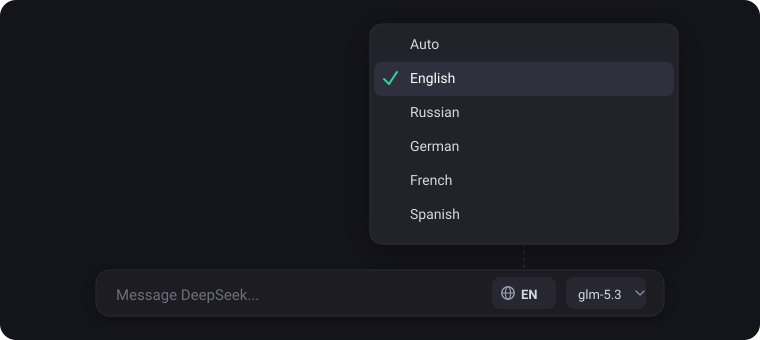
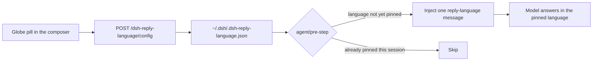

<div align="center">

# dsh-reply-language

**Pick the language. The model answers in it — in every session, every agent.**

A reply-language selector for DeepSeek Harness: a globe pill in the composer,
right next to the model picker. Choose a language and all replies — this
conversation, subagents, teammates, side chats — are written in it. `Auto`
removes the pin.



[](LICENSE)
[](#development)
[](#development)

[Quick start](#quick-start) · [How it works](#how-it-works) · [Languages](#languages) · [Configuration](#configuration) · [Privacy](#privacy) · [Troubleshooting](#troubleshooting) · [Development](#development)

</div>

---

## Highlights

- 🌐 **One pill, global effect** — the choice applies to the whole workspace:
  main sessions, subagents, teammates, and side chats run through the same hook.
- 🧩 **Native composer slot** — registered in the app's own slot system
  (`conversation.input.right`), so it sits in the same control row as the model
  selector and inherits the design tokens, keyboard focus, and dark/light theme.
- 🧹 **Clean transcripts** — one compact `reply-language` inject row per
  language, deduplicated against the session surface and re-affirmed after
  compaction. It is never re-injected on every step.
- 🎯 **16 languages + Auto** — English, Russian, German, French, Spanish,
  Italian, Portuguese, Ukrainian, Turkish, Polish, Dutch, Simplified Chinese,
  Japanese, Korean, Hindi, Arabic.
- 🖼️ **Viewport-safe menu** — the dropdown is portaled to `document.body` and
  clamped to the viewport, so it never slips off-screen or jumps with the
  composer.
- 🔐 **Nothing leaves the machine** — the pill talks only to the local DSH
  webserver; the instruction is applied to messages the host already sends to
  your model provider.
- ⚙️ **Live config** — the config file is re-read on every turn; no restart, no
  reload.
- 🧩 **Zero dependencies** — no install scripts, no native modules, no
  `npm install`.

## Quick start

```sh
dsh plugin --profile desktop add "link:/abs/path/to/dsh-reply-language"
```

Restart DeepSeek Harness once (the host half mounts at startup), then
hard-refresh the browser (Cmd/Ctrl+Shift+R). A globe pill appears left of the
model selector.

Install straight from GitHub:

```sh
dsh plugin --profile desktop add "github:waldemarpng/dsh-reply-language"
```

Pin an exact revision by appending a git ref, for example `#v0.1.0`. For local
development, clone the repository and use the `link:` form above.

## How it works



- The **client half** registers a pill into the `conversation.input.right`
  composer slot. The menu is portaled to `document.body`, positioned by
  measuring the real menu box, and clamped into an 8px viewport margin above or
  below the pill depending on available space.
- The **host half** listens on `agent/pre-step` and injects one compact
  instruction message (`source: reply-language`): *write every user-visible
  reply in X; keep code, identifiers, commands, paths and quoted text
  unchanged; an explicit per-message request still wins.*
- The instruction is injected once per language per session, deduplicated
  against the session surface and re-affirmed after compaction. Changing the
  language injects a new instruction from the next turn; the old row stays in
  history as a harmless superseded entry.

## Languages

| Pill | Language |
|---|---|
| Auto | Follow the conversation — no pin. |
| EN | English |
| RU | Русский |
| DE | Deutsch |
| FR | Français |
| ES | Español |
| IT | Italiano |
| PT | Português |
| UK | Українська |
| TR | Türkçe |
| PL | Polski |
| NL | Nederlands |
| ZH | 中文（简体） |
| JA | 日本語 |
| KO | 한국어 |
| HI | हिन्दी |
| AR | العربية |

## Configuration

Config lives in `~/.dsh/.dsh-reply-language.json` (or `$DSH_HOME/…`), written by
the pill itself and re-read on every turn.

```json
{
  "language": "ru",
  "enabled": true
}
```

| Field | Meaning |
|---|---|
| `language` | `auto` (default) or a supported id: `en`, `ru`, `de`, `fr`, `es`, `it`, `pt`, `uk`, `tr`, `pl`, `nl`, `zh-hans`, `ja`, `ko`, `hi`, `ar`. |
| `enabled` | `false` disables enforcement without losing the choice. |

A broken config never crashes the host: the HTTP route reports the error and
the agent hook quietly behaves like `auto`.

## Routes

| Route | Method | Purpose |
|---|---|---|
| `/dsh-reply-language/config` | GET | Read the current config. |
| `/dsh-reply-language/config` | POST | Update `language` / `enabled` (atomic write, mode 0600). |

Local routes are fenced: cross-site requests, opaque `null` origins, and
origin/host mismatches are rejected; POSTs without browser fetch metadata are
only accepted from loopback.

## Privacy

Nothing leaves the machine: the pill talks only to the local DSH webserver, and
the instruction is applied to messages the host already sends to your model
provider. No telemetry, no third-party service.

## Troubleshooting

<details>
<summary><b>The pill never appears</b></summary>

Restart DeepSeek Harness after installing (the host half mounts at startup),
then hard-refresh the browser (Cmd/Ctrl+Shift+R). Check the browser console for
`/dsh-reply-language/client.js` errors.
</details>

<details>
<summary><b>The pill shows "— / host route unavailable"</b></summary>

The host half is not mounted, so the config route is missing. Re-run the
install, restart the app once, then hard-refresh.
</details>

<details>
<summary><b>The menu opens off-screen or jumps</b></summary>

The menu is portaled to `document.body` and clamped to the viewport. If it
still misbehaves, hard-refresh to make sure the latest bundle is loaded — the
host serves each build under a new revision hash.
</details>

<details>
<summary><b>The language change takes effect only on the next turn</b></summary>

By design. The instruction is injected at the next `agent/pre-step`, so the
very first reply after switching still follows the previous language.
</details>

<details>
<summary><b>The model still answers in another language</b></summary>

A later user message asking for a specific language overrides the pin for that
message — that is intentional. Otherwise check that `enabled` is `true` and the
config file parses: `cat ~/.dsh/.dsh-reply-language.json`.
</details>

## Resource lifecycle

The plugin leaks nothing. The config route is disposed with its webserver
scope, and the `agent/pre-step` hook and route registration are tied to the
plugin fiber. On the client, every document/window listener is removed in its
effect cleanup, the portaled menu is unmounted with React, and the injected
`<style>` is deduplicated. No timers, no intervals, no unbounded caches.

## Development

Node.js ≥ 20, zero dependencies, no build step.

| Command | What it does |
|---|---|
| `npm run check` | Syntax-check every module. |
| `npm test` | Offline tests: config, instruction dedupe, routes, client registration, menu placement. |
| `npm run guard` | Fails on comments or non-ASCII characters in code (localized label files exempt). |
| `npm run smoke` | Live check against a running host: `DSH_URL` env picks the server, defaults to `http://127.0.0.1:62498`. |

## License

MIT — see [LICENSE](LICENSE).
